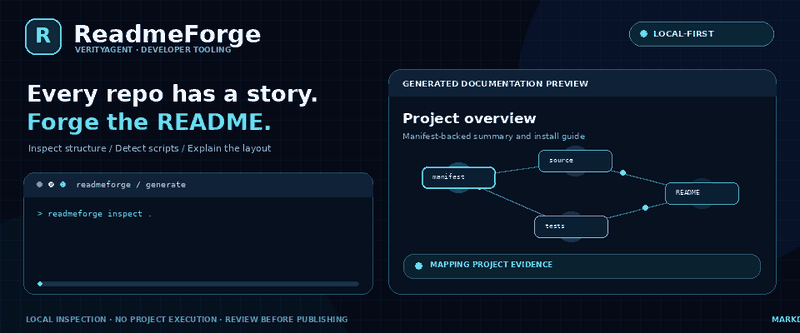
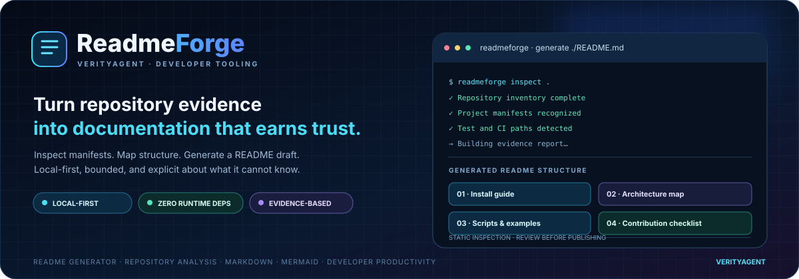
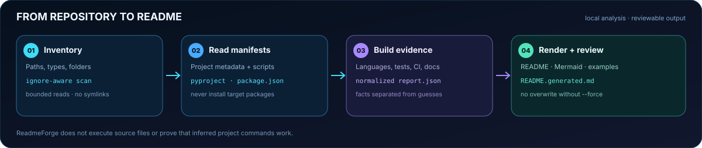

  

<h1 align="center">ReadmeForge</h1>

  <strong>Turn repository evidence into documentation developers can trust.</strong> 
  A local-first README generator by <strong>VerityAgent</strong>. It inspects project manifests and file structure, then drafts installation guidance, script references, architecture diagrams, and contribution instructions.

  <a href="#quick-start">Quick start</a> ·
  <a href="#visual-workflow">Visual workflow</a> ·
  <a href="docs/ARCHITECTURE.md">Architecture</a> ·
  <a href="docs/USAGE.md">Usage</a>

  
  
  
  
  

> **v0.1.0 alpha · zero mandatory runtime dependencies.** ReadmeForge reads file metadata and selected bounded manifests locally. It does not import or execute the repository being inspected and makes no network requests.

---

## The hook: make an unfamiliar repository explain itself

A strong README should answer a developer's first questions: What is here? How do I install it? Where is the source? Which commands are declared? How is the repository organized?

ReadmeForge builds a first draft from evidence rather than pretending to understand unobserved runtime behavior.

  

## What it generates

| README section | Evidence used |
|---|---|
| Project introduction | Package name and description from recognized manifests, with a cautious fallback if absent |
| Installation guidance | Common manifests such as pyproject.toml, package.json, Cargo.toml, go.mod, composer.json, or Gemfile |
| Usage examples | Declared package scripts and Python console-script metadata when available |
| Architecture overview | Mermaid map from detected folders, manifests, tests, docs, and CI paths |
| Repository signals | Language counts, manifests, license and testing evidence, not invented product capabilities |
| Test instructions | Candidate commands inferred from familiar test folders and manifest scripts, labeled for review |
| Contribution and security guidance | A reviewable baseline checklist with reminders to verify project-specific details |

## Visual workflow

  

## Quick start

Python 3.10 or newer. Runtime operation uses the Python standard library.

~~~bash
git clone https://github.com/muhammadsaeed-ai/verity-readme-forge.git
cd verity-readme-forge
python -m venv .venv
~~~

Activate the virtual environment, then install the package.

**Windows PowerShell**

~~~powershell
.\.venv\Scripts\Activate.ps1
python -m pip install .
~~~

**macOS / Linux**

~~~bash
source .venv/bin/activate
python -m pip install .
~~~

## Generate your first README

Start with a separate draft so you never lose an existing README:

~~~bash
readmeforge inspect /path/to/project
readmeforge generate /path/to/project --output README.generated.md
~~~

Review the generated file. Replace a project's README only when you're ready:

~~~bash
readmeforge generate /path/to/project --output /path/to/project/README.md --force
~~~

The force option is required for an existing destination. ReadmeForge never silently overwrites human-authored documentation and does not merge generated text with existing prose.

## Useful commands

~~~bash
readmeforge inspect .
readmeforge inspect . --format json --output readmeforge-report.json
readmeforge generate . --output README.generated.md --exclude "generated/**" --exclude "*.snap"
readmeforge check .
~~~

Exit codes for <code>check</code>: <code>0</code> means the file exactly matches generated content, <code>1</code> means it is missing or different, and <code>2</code> indicates an inspection or usage error.

## Trust is built into the workflow

- **Local-first:** no upload or telemetry request is made.
- **No target-code execution:** inspected modules are never imported, run, or installed.
- **Bounded:** file inventory and manifest reads have size limits.
- **Safer file handling:** symlinks are skipped; caches, virtual environments, build outputs, and vendor folders are excluded by default.
- **No surprise overwrite:** existing output requires an explicit <code>--force</code>.
- **Evidence over fiction:** inferred commands are recommendations, not proof that a program runs; folders are not turned into claims about implemented features.
- **Reviewable output:** source contents are not embedded into reports, which store relative paths rather than the absolute machine path.

## Development and tests

~~~bash
python -m pip install -e ".[dev]"
python -m pytest
python -m ruff check src tests
python -m build
~~~

CI is configured for Python 3.10–3.14 on Ubuntu, Windows, and macOS. Workflow badges reflect their latest run, not a security certification or proof of production readiness.

## Current boundaries

ReadmeForge is an alpha documentation assistant, not an autonomous source-code reviewer. It does not infer true business logic, run tests in the target repository, validate external services, prove licenses are legally appropriate, or guarantee that detected commands succeed. It supports common manifest conventions and provides a structured starting point that maintainers should review.

## Documentation

- [Architecture and safety model](docs/ARCHITECTURE.md)
- [Usage guide](docs/USAGE.md)
- [Contributing](CONTRIBUTING.md)
- [Security policy](SECURITY.md)
- [Changelog](CHANGELOG.md)

## Project identity and discovery

ReadmeForge is a developer productivity tool from **VerityAgent**, focused on professional README generation, Markdown documentation, architecture diagrams, project inspection, and trustworthy developer workflows.

Suggested GitHub topics: <code>readme-generator</code>, <code>github-readme</code>, <code>documentation-generator</code>, <code>markdown</code>, <code>repository-analysis</code>, <code>architecture-diagrams</code>, <code>developer-tools</code>, <code>developer-productivity</code>, <code>python</code>, <code>open-source</code>.

  <strong>ReadmeForge · Your project already has evidence. Turn it into a story.</strong>

