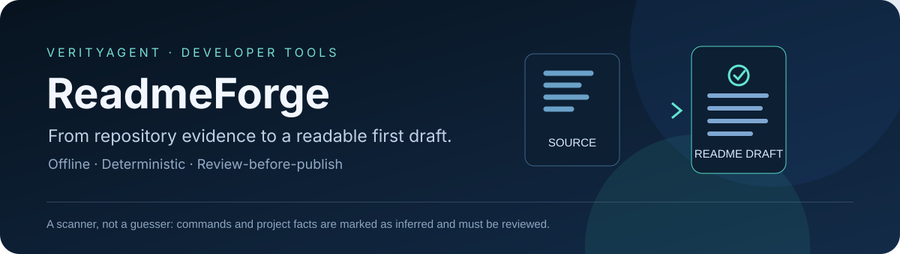
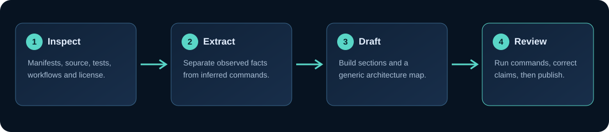
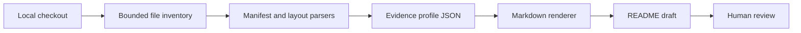

<p align="center">
  
</p>

<p align="center"><strong>From a codebase to a README draft that tells you what it actually found.</strong></p>
<p align="center"><sub>Built and maintained by <a href="https://verityagent.lovable.app"><strong>VerityAgent</strong></a> · Open-source developer tooling</sub></p>

<p align="center">
  
  
  
  <a href="https://github.com/muhammadsaeed-ai/verity-readme-forge/actions/workflows/ci.yml"></a>
</p>

**ReadmeForge** is an offline-first README starter generator. It inspects local project manifests, entry points, tests, source layout, license files, and GitHub Actions workflows, then produces a structured Markdown draft. It does not install dependencies, import the project, execute scripts, or upload source code.

<p align="center"></p>

## Why it is different

- **Evidence-backed project facts.** Language, package metadata, test files, CI workflows, license presence, entry points, and selected dependencies come from files found in the checkout.
- **Offline by default.** The scanner reads local files only; it makes no API calls and does not require an API key.
- **Preserves the original README.** Default output is `README.generated.md`. An existing target is never overwritten unless `--force` is explicitly supplied.
- **Honest about inference.** Suggested install/run commands may require review. The generated architecture diagram is explicitly labeled as generic until a project-specific design is supplied.
- **Useful in automation.** `inspect --json` emits a versioned machine-readable profile that can be used by other local tooling.

## Quick start

Requires Python 3.10 or newer.

```bash
git clone https://github.com/muhammadsaeed-ai/verity-readme-forge.git
cd verity-readme-forge
python -m venv .venv
```

Activate the environment, then install:

```bash
# Linux / macOS
source .venv/bin/activate
# Windows PowerShell
.\.venv\Scripts\Activate.ps1

python -m pip install -e .
```

### Inspect a project

```bash
readmeforge inspect /path/to/project
readmeforge inspect /path/to/project > profile.json
```

The profile includes detected name/description, language, package manager, available entry points, declared dependencies, source and test file samples, workflow paths, license presence, and notes where evidence is missing.

### Generate a README draft

```bash
readmeforge generate /path/to/project
# Writes README.generated.md without touching README.md

readmeforge generate /path/to/project --output docs/README-draft.md
# Replace an existing target only when you explicitly choose to do so
readmeforge generate /path/to/project --output README.md --force
```

### Run from a source checkout

```bash
python -m readmeforge.cli --help
python -m readmeforge.cli inspect .
```

## What the scan observes

| Area | Evidence used | Limitation |
|---|---|---|
| Project identity | `pyproject.toml`, `package.json`, README headings | Names/descriptions can still be generic or stale |
| Install and run hints | Packaging manifests, declared scripts, test layout | Commands are inferred, not executed to verify they succeed |
| Source layout | Bounded inventory of common source extensions and directories | Large inventories are capped to prevent runaway scans |
| Tests | Conventional `tests/`, `test/`, and common test filenames | A detected test file does not mean the tests pass |
| CI | `.github/workflows/*.yml` and `.yaml` | Workflow files are listed, not executed or audited for semantics |
| License | Common license filenames | File existence does not replace reviewing the license text |
| Dependencies | Supported project/runtime manifest declarations | Transitive dependency resolution is not performed |

## Architecture



The scanner and renderer are deterministic: the same inspected files and runtime produce the same profile and draft, apart from the absolute root path recorded in the profile. No project source is imported or executed.

## Development and tests

```bash
python -m pip install -e ".[dev]"
python -m unittest discover -s tests -v
ruff check src tests
python -m build
```

GitHub Actions runs the tests, lint check, CLI smoke check, and package build against Python 3.10–3.14.

## Security and scope

ReadmeForge treats repository contents as data. It skips common generated/vendor directories, does not follow directory symlinks, skips file symlinks, caps the inventory at 5,000 files, and limits individual text reads. It does not execute discovered commands. Review the generated README before publication; it is a reviewed starting point, not a claim that the target project is correct, secure, production-ready, or fully tested.

## Roadmap

- Add project-specific architecture templates selected by explicit configuration.
- Add plugin interfaces for additional manifest ecosystems.
- Add optional machine-readable custom section definitions without making external AI a runtime requirement.

## License

MIT. See [`LICENSE`](LICENSE).
